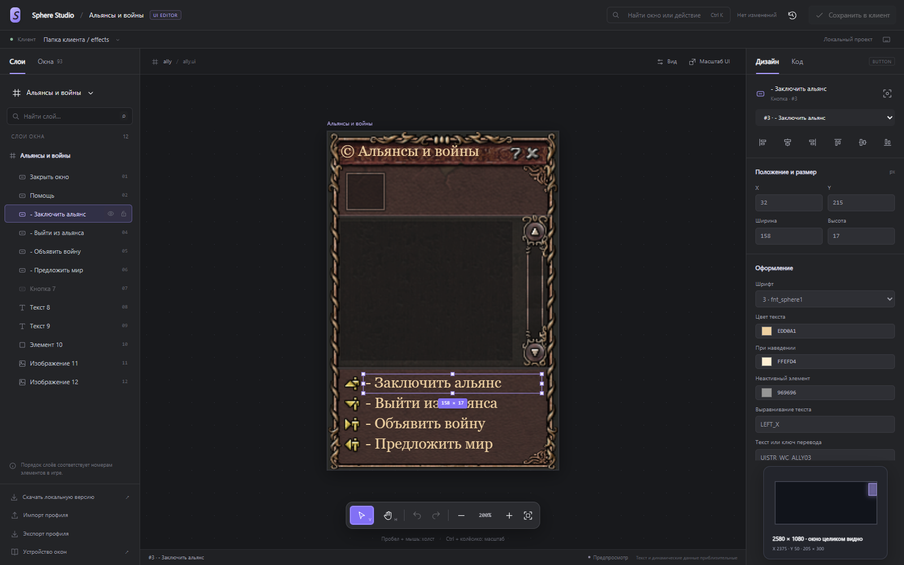

# Sphere Studio

Визуальный редактор интерфейса Сферы: слои, свободный холст, направляющие, профили и резервные копии. Работает на сайте и локально.



## Открыть через интернет

**[Открыть Sphere Studio](https://o2inv.ru/sphere/ui/)**. Установка не нужна.

1. Откройте сайт на компьютере и нажмите «Открыть папку игры».
2. Выберите папку клиента через диалог браузера и разрешите запись.
3. Настройте интерфейс и нажмите «Сохранить в клиент» или `Ctrl S`.
4. Перезапустите игру, чтобы увидеть изменения.

В Chrome и Edge сайт записывает изменения прямо в выбранную папку. Перед записью создаются локальные резервные копии, доступные через кнопку истории. Папку можно открыть повторно из списка недавних; браузер может попросить подтвердить доступ заново. Сайт не получает полный системный путь: в онлайн-режиме отображается имя выбранной папки.

Игровые файлы, текстуры, профили и бэкапы **не отправляются на сервер**. Разбор, предпросмотр, проверка SHA-256 и запись выполняются в браузере на компьютере пользователя. Разрешение относится только к выбранной папке; сайт не сканирует диски самостоятельно.

| Режим                                        | Как сохраняются изменения                                                                                                        |
| -------------------------------------------- | -------------------------------------------------------------------------------------------------------------------------------- |
| Сайт в Chrome / Edge                         | Прямая запись в выбранную папку и бэкапы рядом с игрой                                                                           |
| Сайт в Firefox и браузерах без прямой записи | Папка открывается для редактирования; результат и исходники для восстановления скачиваются в ZIP. Распакуйте его в папку клиента |
| Локальная версия                             | Запись через локальный Node.js, работающий только на `127.0.0.1`; браузерное разрешение на папку не требуется                    |

Это ограничение [браузерного доступа к локальным файлам](https://developer.chrome.com/docs/capabilities/web-apis/file-system-access). Редактор определяет доступные возможности автоматически и явно показывает режим ZIP, если прямая запись недоступна.

## Запуск локально

1. Скачайте этот репозиторий через **Code → Download ZIP** и распакуйте.
2. Установите Node.js 22 или новее, если он ещё не установлен.
3. В Windows запустите `Start-Editor.cmd`. Он откроет `http://127.0.0.1:5189` в браузере.
4. Выберите свою папку клиента игры.

Можно также выполнить `npm start` или `node server.mjs` из папки проекта. Установка npm-пакетов для работы редактора не нужна.
При первом запуске выберите папку клиента через диалог или введите путь вручную.
Заранее заданных адресов копий игры нет. В локальной версии последняя выбранная папка и история открытий хранятся в `.run/settings.json`, который не входит в Git. На сайте разрешённые пользователем папки запоминаются браузером.
Кнопка «Найти внутри папки» ищет копии только внутри указанного каталога, до трёх уровней вложенности, максимум 2000 папок. В локальной версии полный путь к текущей копии виден над рабочей областью.

Можно передать папку и порт при запуске:

```powershell
.\Start-Editor.ps1 -Client <путь-к-клиенту> -Port 5191
```

Вкладка «Окна» и поиск `Ctrl K` открывают окна клиента. Во вкладке «Слои» доступны все элементы с сохранением их игровых номеров. Свойства находятся справа; вкладка «Код» показывает исходное описание.

## Работа с холстом

На холсте можно:

- Выделять кликом или рамкой, добавлять элементы через Shift или Ctrl.
- Двигать и менять размер нескольких элементов вместе, выравнивать и распределять их.
- Пользоваться направляющими и привязкой; Alt при перетаскивании временно отключает привязку.
- Двигать холст пробелом с мышью, средней кнопкой или инструментом «Рука» (`H`).
- Приближать к курсору через Ctrl с колёсиком. `Shift 1` вписывает окно, `Shift 2` приближает выделение.
- Перемещать окно за подпись над рамкой, менять размер через восемь маркеров.
- Отменять и повторять действия (`Ctrl Z`, `Ctrl Shift Z`), сохранять через `Ctrl S`.
- Копировать и вставлять свойства существующих элементов (`Ctrl Alt C`, `Ctrl Alt V`).

Значки глаза и замка относятся к редактору: они управляют предпросмотром и защитой от случайных перемещений. Элементы с `hidden true` изначально скрыты на холсте. Неизвестные ключи `UISTR_*` объясняются в свойствах и не рисуются как надписи. Содержимое окна обрезается по его границе.

«Масштаб UI» меняет геометрию в файлах игры, независимо от приближения холста. Повторный выбор 150% не превращает размер в 225%: расчёт идёт от прочитанных файлов. Растровые буквы сохраняют свой размер; для текста можно выбрать другой существующий шрифт.

Изменения записываются только по кнопке «Сохранить в клиент». После сохранения перезапустите игру.
Перед каждой записью создаётся резервная копия в `<клиент>\_interface-editor-backups`.
История позволяет восстановить точные исходные байты. Сверка SHA-256 защищает от перезаписи файла, который успел изменить другой инструмент.
Профили JSON позволяют переносить оформление между совместимыми копиями клиента.

Предпросмотр использует текстуры игры. Растровые шрифты воспроизводятся приблизительно; модели, анимации и данные персонажей заполняются игровыми сценариями и здесь не исполняются. Редактор сохраняет `.ui`, кодировку Windows-1251, комментарии и порядок элементов; `.mbc` и исполняемый файл не меняются.

Анимации панелей, диалогов и приближения учитывают системную настройку уменьшения движения.

[Устройство окон и переход к выбору персонажа](WINDOWS.md).
Картотеку окон можно сгенерировать из своей копии клиента; игровые файлы и ресурсы не входят в репозиторий.

## Проверки для разработки

`npm test` запускает автономные тесты разбора файлов, сохранения и текстур. Клиент игры для них не нужен.

`npm run test:online -- <путь-к-клиенту>` проверяет статическую версию под вложенным адресом, реальный браузерный FileSystemWritableFileStream в изолированной тестовой папке браузера, IndexedDB, конфликты, откат, DDS и ZIP. Файлы исходной игры не изменяются. `BROWSER=firefox` запускает проверки режима ZIP в Firefox.

`node test.mjs <путь-к-клиенту>` проверяет разбор и сохранение файлов, API, геометрию и действия в браузере на отдельной временной копии. Исходная игра не изменяется. Для браузерных проверок нужен Playwright с Chromium; можно указать `PLAYWRIGHT_MODULE` и `CHROMIUM` через переменные окружения.

Для обычной установки браузерных проверок:

```powershell
npm install --no-save playwright
npx playwright install chromium
npm run test:client -- <путь-к-клиенту>
```

Генерация картотеки: `node generate-catalog.mjs <путь-к-клиенту> [каталог-current-mbc] [каталог-старого-декомпилятора]`.

## Размещение сайта

`npm run build` создаёт `dist/` со статической браузерной версией. Её можно разместить по HTTPS в корне сайта или в подпапке: пути к скриптам и стилям относительные. На сервере не нужны Node.js и доступ к каталогам пользователей.
В сборку входят только файлы интерфейса редактора, общий парсер и декодер DDS; локальные API, настройки, игровые файлы и ключи в неё не попадают.
Пример конфигурации Nginx и порядок обновления: [deploy/README.md](deploy/README.md).
